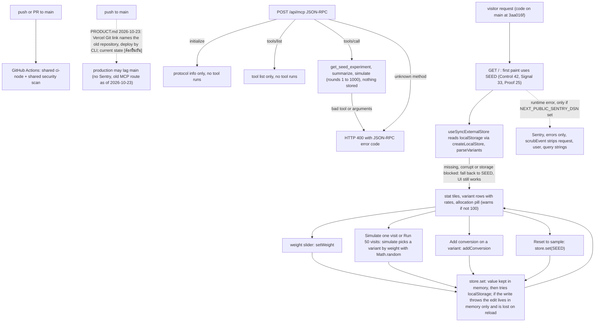
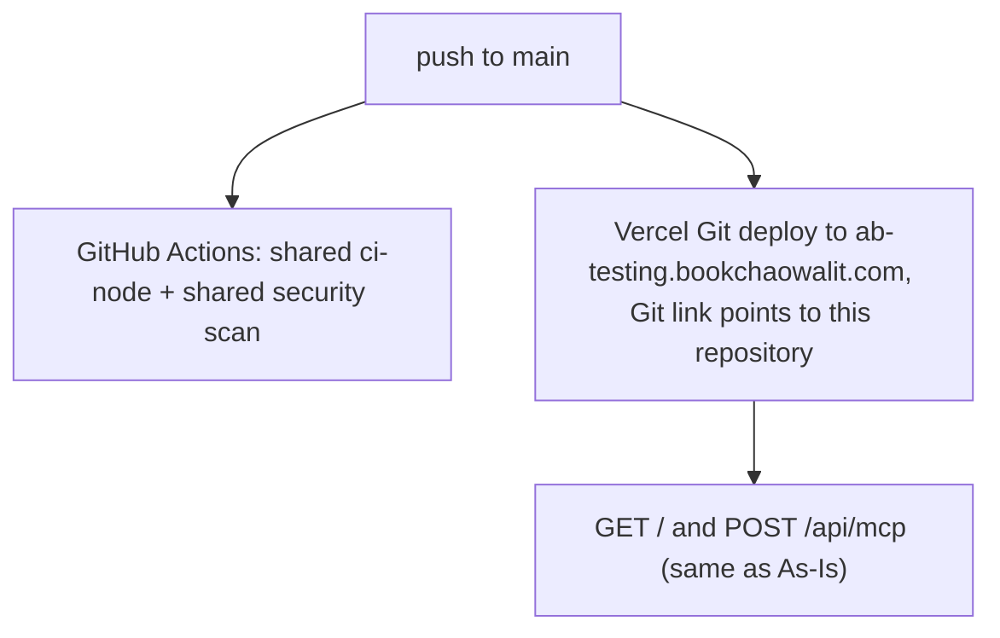

# 01 — Business process (As-Is / To-Be)

marketing-ab-testing-web คือตัวจำลองการแบ่งทราฟฟิก A/B 3 variant (ab-testing.bookchaowalit.com) ทำงานใน browser และเก็บสถานะใน localStorage พร้อม endpoint `/api/mcp` แบบ stateless ที่ใช้ตรรกะชุดเดียวกัน ไม่มีผู้เยี่ยมชมจริงหรือข้อมูลจริง

Last reviewed: 2026-11-28 · commit `3aa016f`

## As-Is (จากโค้ดวันนี้)

Sources: `app/page.tsx`, `lib/ab-testing.ts`, `lib/local-store.ts`, `app/api/mcp/route.ts`, `lib/site.ts`, `lib/sentry.ts`, `next.config.ts`, `PRODUCT.md`

ข้อเท็จจริงจากโค้ด: route `/api/mcp` มองไม่เห็นข้อมูลใน browser ของผู้เยี่ยมชม และไม่มี auth/rate limit ในโค้ด (เปิดสาธารณะ, stateless); ไม่มี significance test; ไม่มี analytics ใน `package.json`. [ต้องยืนยัน] สถานะ deploy ปัจจุบัน (PRODUCT.md บันทึกเมื่อ 2026-10-23).

## To-Be (PRODUCT.md §Live URL and deploy state)

Sources: `PRODUCT.md` (owner action D9: reconnect Vercel Git to this repository)

## Gap

| ID | As-Is → To-Be | Status | Owner | Evidence |
|---|---|---|---|---|
| G1 | Vercel Git link ชี้ repo เก่า, deploy ด้วย CLI → เชื่อมกับ repo นี้ให้ push to `main` deploy เอง | decide | owner | `PRODUCT.md` §Live URL and deploy state (owner action D9) |

## Open questions

- production มี Sentry และ MCP route ปัจจุบันหรือยัง (PRODUCT.md บันทึกว่า live site ล้าหลัง `main` เมื่อ 2026-10-23)
